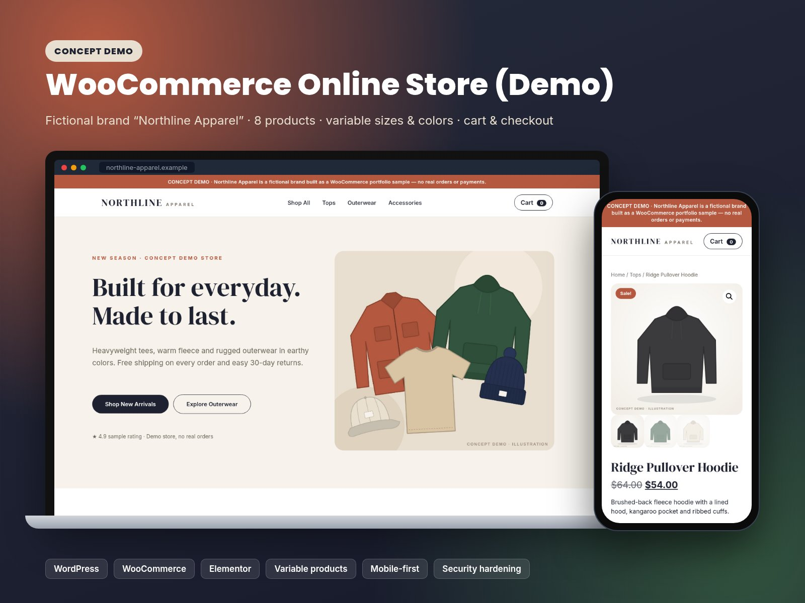
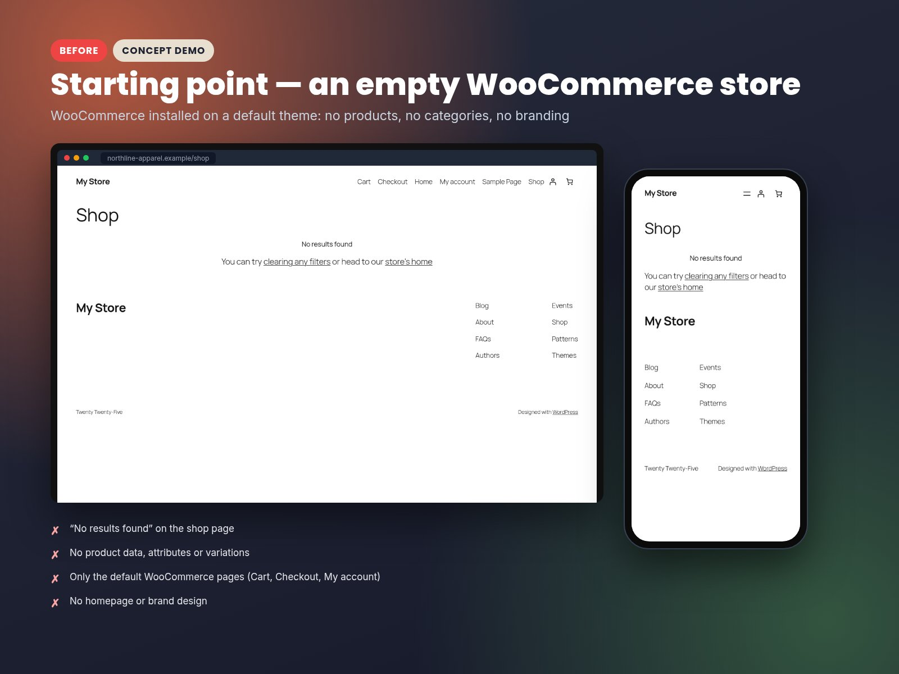
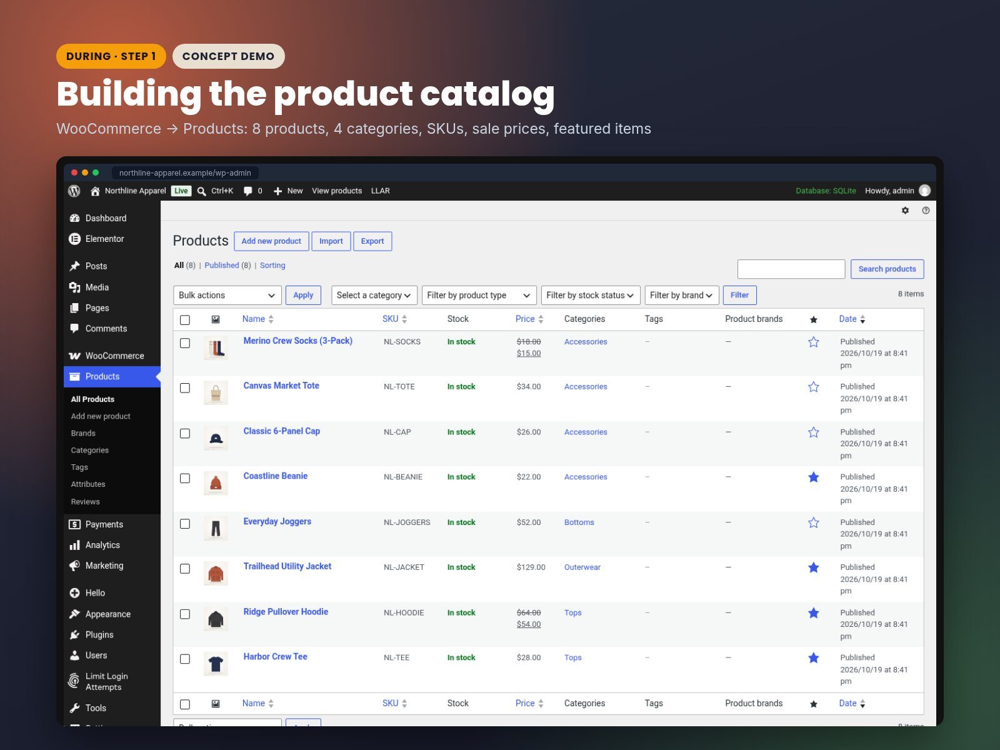
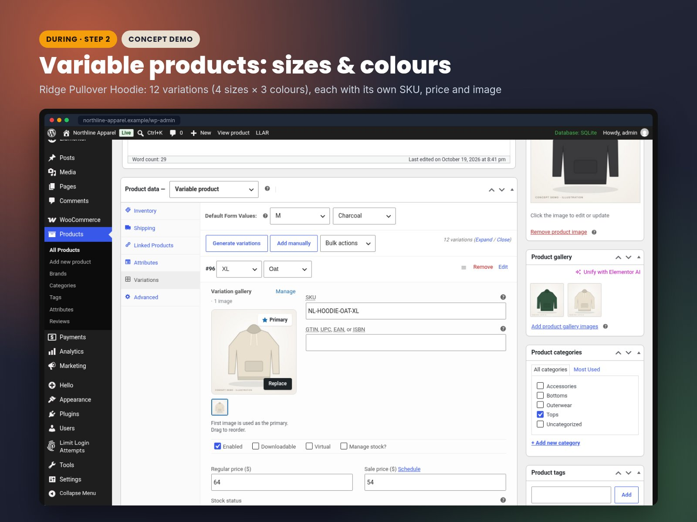
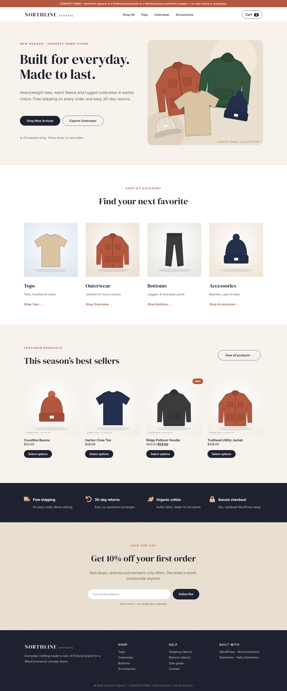
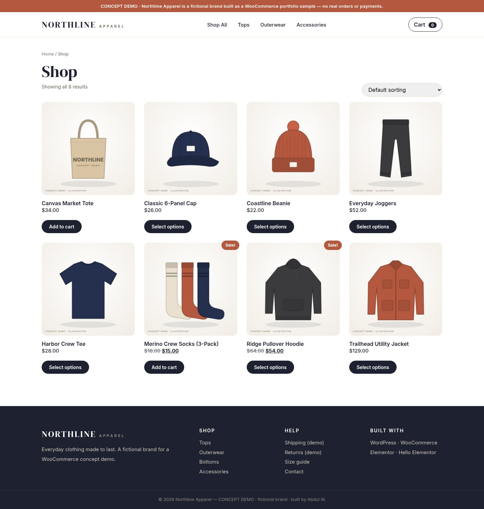
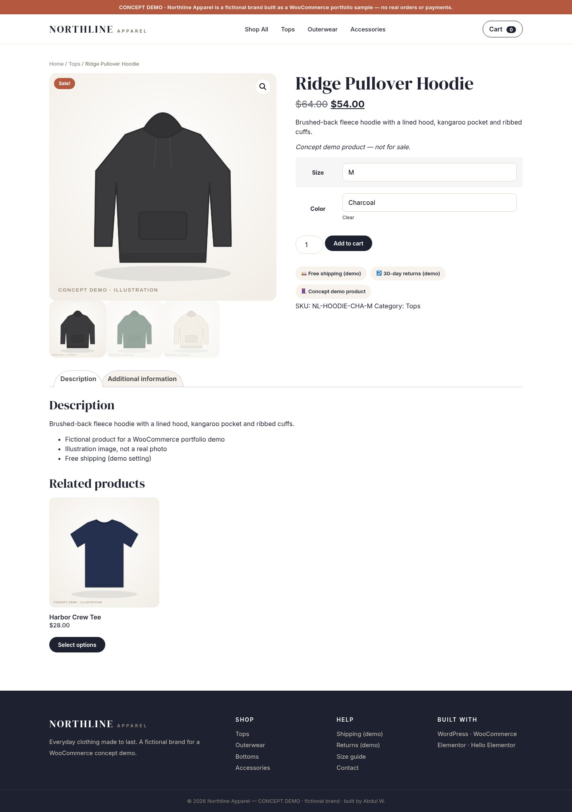
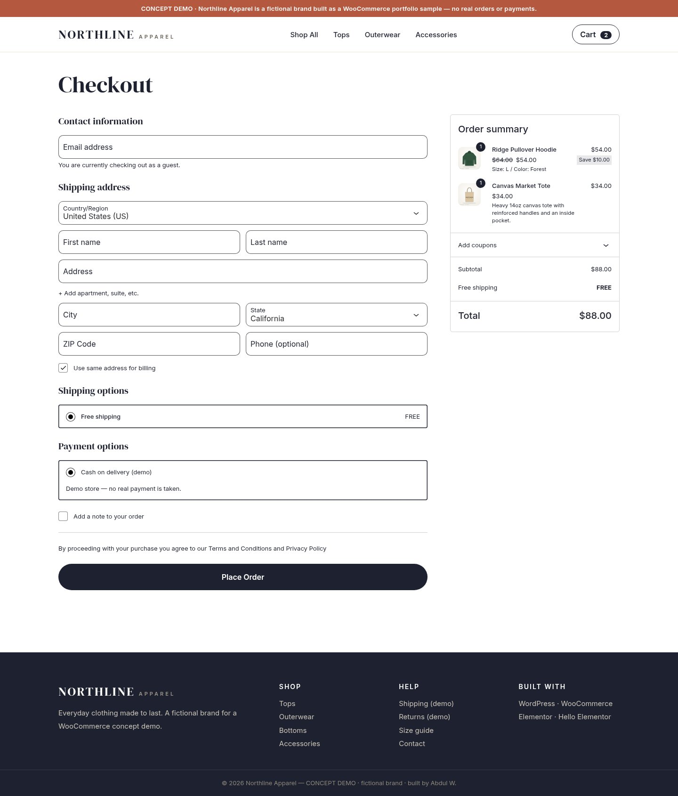
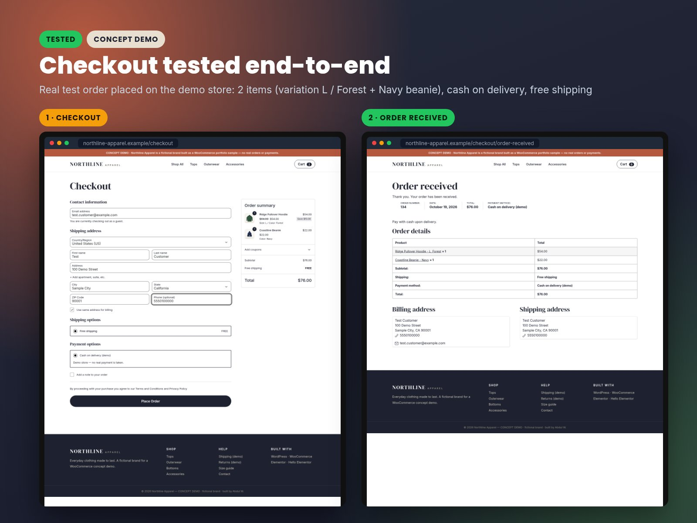
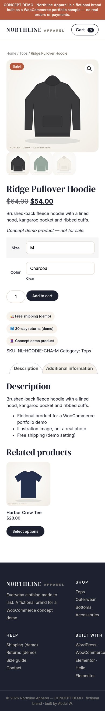

# Northline Apparel — WooCommerce Clothing Store (Elementor)

> **Concept demo with sample data.** Northline Apparel is a fictional brand; products, prices and orders are sample data. Not a real client project.

## What was built
- WooCommerce store with **8 products** in categories (tops, bottoms, outerwear, accessories), sale prices and **variable products** (e.g. one hoodie with 12 size/colour variations)
- Homepage designed in Elementor; styled shop, product, cart and checkout pages
- Custom header/footer via a must-use plugin
- **Tested purchase flow:** add to cart → checkout → test order (Cash on Delivery) → verified in WooCommerce admin
- Responsive on desktop and mobile, with basic security hardening

## Process: before → during → after
### Before: empty store

### During: product catalog in admin

### During: size/colour variations

### After: homepage (desktop)

### After: shop page

### After: product page

### Checkout

### Tested: order received

### After: product page (mobile)

## Tech stack
WordPress 6.x · WooCommerce · Hello Elementor · Elementor (free) · custom MU-plugin (PHP) · Limit Login Attempts Reloaded · WP-CLI

## Repository contents
| Path | What it is |
|---|---|
| `code/elementor/northline-homepage-elementor-template.json` | Elementor homepage template |
| `code/mu-plugins/northline-demo-mu-plugin.php` | Header/footer + store tweaks (drop into `wp-content/mu-plugins/`) |
| `code/security/nginx-security-snippet.conf` | Reference Nginx hardening rules |
| `docs/HOW-I-BUILT-IT.md` | Step-by-step build guide |

## Run it locally (LocalWP)
1. Create a new site in [LocalWP](https://localwp.com/) (choose your own admin username and password).
2. Install and activate **Hello Elementor**, **Elementor** and **WooCommerce**; run the WooCommerce setup wizard.
3. Copy `code/mu-plugins/northline-demo-mu-plugin.php` into `wp-content/mu-plugins/` (create the folder if missing). It activates automatically.
4. Add products and categories (see the guide), including a variable product with size/colour attributes.
5. Import `code/elementor/northline-homepage-elementor-template.json` via **Templates → Saved Templates → Import**, insert it into a new page and set it as the homepage. Re-select images.
6. Enable **Cash on Delivery** under WooCommerce → Settings → Payments and place a test order.
7. Full details: [docs/HOW-I-BUILT-IT.md](docs/HOW-I-BUILT-IT.md).

## Author

**Abdul Wahab — AWL Solutions**
WordPress, Elementor & WooCommerce developer · [Hire me on Upwork](https://www.upwork.com/freelancers/~01070211c5bbfca5e8)

## License

Code is released under the [MIT License](LICENSE).
